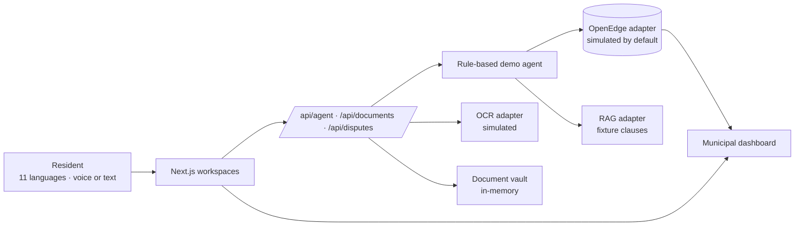

# Ubuntu Desk 🇿🇦

**A multilingual municipal services demo for the AIGS / Progress OpenEdge Innovation Challenge 2026.**

Residents get electricity and water bills they cannot explain. Estimated readings are a common cause. Disputing one today means a queue, an explanation in English, and a wait. Ubuntu Desk is the product direction for a resident to ask in their own language, show the bill, see the calculation and the clause, and confirm a dispute.

**This build is a labelled demo.** Account lookup, policy answers, billing checks, and OCR are simulated. It is not connected to a live municipality, and it does not claim that OpenEdge or Progress Agentic RAG are already answering in production. The product plan is [ROADMAP.md](ROADMAP.md). The competition schedule is [PLAN.md](PLAN.md).

## What the demo does

1. The resident picks one of the 11 official languages and sends text or speech.
2. A rule-based agent loads a **simulated** account and **fixture** by-law clauses, then shows its steps.
3. English, isiZulu, and Sesotho get a reviewed demo script. The browser speaks it when that voice is available. The other eight languages get an English “coming soon” placeholder — the app does not invent a fluent reply.
4. Scan & Documents accepts a camera frame, an upload, or the bundled sample bill. OCR is **simulated**. The file is kept in an in-memory vault and can be linked to a case.
5. When a bill is present, the screen shows each calculation step and the tariff clause. A mismatch is a **potential billing error** until records confirm it.
6. The resident must tick a confirmation before a dispute is submitted. The case then shows draft → submitted → under review → resolved. Staff status changes in the dashboard are simulated too.

Speech-recognition confidence (from the browser, when it reports one) is shown separately from retrieval groundedness. Groundedness here is a demo score on the fixture answer. It is not proof of a translation or a legal conclusion.

## Language support

| Code | Language | Typed demo | Spoken demo | Reply |
|---|---|---|---|---|
| `en` | English | Yes | Browser speech where available | Reviewed demo script |
| `zu` | isiZulu | Yes | Browser speech where available | Reviewed demo script |
| `st` | Sesotho | Yes | Browser speech where available | Reviewed demo script |
| `af` | Afrikaans | Selectable | Browser may transcribe | Coming soon — English placeholder |
| `xh` | isiXhosa | Selectable | Browser may transcribe | Coming soon — English placeholder |
| `nso` | Sepedi | Selectable | Browser may transcribe | Coming soon — English placeholder |
| `tn` | Setswana | Selectable | Browser may transcribe | Coming soon — English placeholder |
| `ss` | siSwati | Selectable | Browser may transcribe | Coming soon — English placeholder |
| `ve` | Tshivenda | Selectable | Browser may transcribe | Coming soon — English placeholder |
| `ts` | Xitsonga | Selectable | Browser may transcribe | Coming soon — English placeholder |
| `nr` | isiNdebele | Selectable | Browser may transcribe | Coming soon — English placeholder |

isiZulu and Sesotho lines are demo scripts for the prototype, not certified translations.

## Scan and documents

Open **Scan & Documents**.

- **Load sample bill** uses `public/sample-bill.svg` (account `JHB-4471-0093`, period `2026-09`, 1020 kWh estimated, total R3,107.00).
- **Open camera** uses the device camera when the browser allows it. A captured frame is stored. This build does not read pixels, so the fields fall back to the sample bill and say so.
- **Upload image or PDF** stores the file. If the file contains labelled text (the sample SVG does), a simulated text match can fill account, period, and total. That match is not an OCR engine. Photos and most PDFs are not read.
- Categories: bill, meter photo, receipt, infrastructure, other. Bill maths runs for bills.
- The vault is process memory. It is cleared when the server restarts. Link a stored bill to a case id from the list.
- Previews are shown for the sample SVG and for small PNG, JPEG, or WebP uploads. Other types keep a filename only.

OCR and storage sit behind `OcrClient` and `DocumentStore` in `src/lib/types.ts`. Simulated implementations are the default. Scaffolds live in `src/lib/adapters/real/ocr.ts` and `real/documents.ts`.

## Technical approach

| Layer | In this demo | Later |
|---|---|---|
| System of record | `mock/openedge.ts` | Progress OpenEdge via PASOE REST |
| Knowledge | Fixture clauses and fixture retrieval scores | Progress Agentic RAG, with real citations and REMi scores |
| Billing | Rule-based cap check in `src/lib/billing.ts` | Tariff service plus verified readings |
| OCR / vault | Simulated extractor and in-memory vault | Pluggable OCR and private object storage |
| Agent | `src/lib/agent.ts` shows each step | Tool calling over tested adapters |
| Voice | Web Speech API | Reviewed voices per language |
| UI | Next.js 15, React 19, Tailwind 4 | Same app, three workspaces |

Interfaces in `src/lib/types.ts`:

- `OpenEdgeClient`: `getAccount`, `createDispute`, `updateDispute`, `listDisputes`
- `RagClient`: `ask`
- `OcrClient`: `extract`
- `DocumentStore`: `save`, `list`, `linkToCase`

`src/lib/adapters/index.ts` selects the implementation:

```
USE_REAL_OPENEDGE=1   OPENEDGE_BASE_URL=...   OPENEDGE_TOKEN=...
USE_REAL_RAG=1        RAG_API_URL=...   RAG_KB_ID=...   RAG_API_KEY=...
USE_REAL_OCR=1        OCR_API_URL=...   OCR_API_KEY=...
USE_REAL_DOCUMENTS=1  DOCUMENT_STORE_URL=...   DOCUMENT_STORE_TOKEN=...
```

Leave these unset for the demo. Do not commit tokens. A real adapter that has not been tested is labelled **unverified** in the header. It is still not a live municipal integration.



## Setup

Node 20 or newer.

```bash
npm install
npm run dev        # http://localhost:3000
npm run build && npm start
```

## Demo URLs

| URL | What it does |
|---|---|
| `http://localhost:3000` | Resident workspace, isiZulu sample text |
| `/?autorun=1&lang=zu` | Runs the isiZulu demo and stops on the confirmation checkbox |
| `/?autorun=1&lang=st&fast=1` | Sesotho, short delays |
| `/?autorun=1&lang=en&confirm=1&fast=1` | English, and the autorun URL confirms the dispute |
| `/?lang=xh` | isiXhosa selected, coming-soon path |
| `/?workspace=scan&sample=1` | Opens Scan & Documents and loads the sample bill |
| `/?workspace=dashboard` | Simulated case list |

`confirm=1` is a presentation shortcut. In ordinary use the resident has to tick the box. `fast=1` skips the step delay and does not speak.

## Screenshots

The resident workspace: idle, then the isiZulu and Sesotho demos stopped on the confirmation step. Scan & Documents is the `/?workspace=scan&sample=1` URL.

| Idle | isiZulu flow | Sesotho flow |
|---|---|---|
|  |  |  |

## Project layout

```
src/app/api/agent/route.ts       demo agent
src/app/api/documents/route.ts   vault, simulated OCR, bill analysis
src/app/api/disputes/route.ts    confirm, list, simulated status changes
src/lib/agent.ts                 rule-based steps
src/lib/billing.ts               calculation shown in the UI
src/lib/languages.ts             11 official languages
src/lib/adapters/mock/           simulated OpenEdge, RAG, OCR, vault
src/lib/adapters/real/           scaffolds only
public/sample-bill.svg           bundled sample statement
ROADMAP.md                       2.0 product direction
PLAN.md                          competition plan through 29 Oct 2026
```
