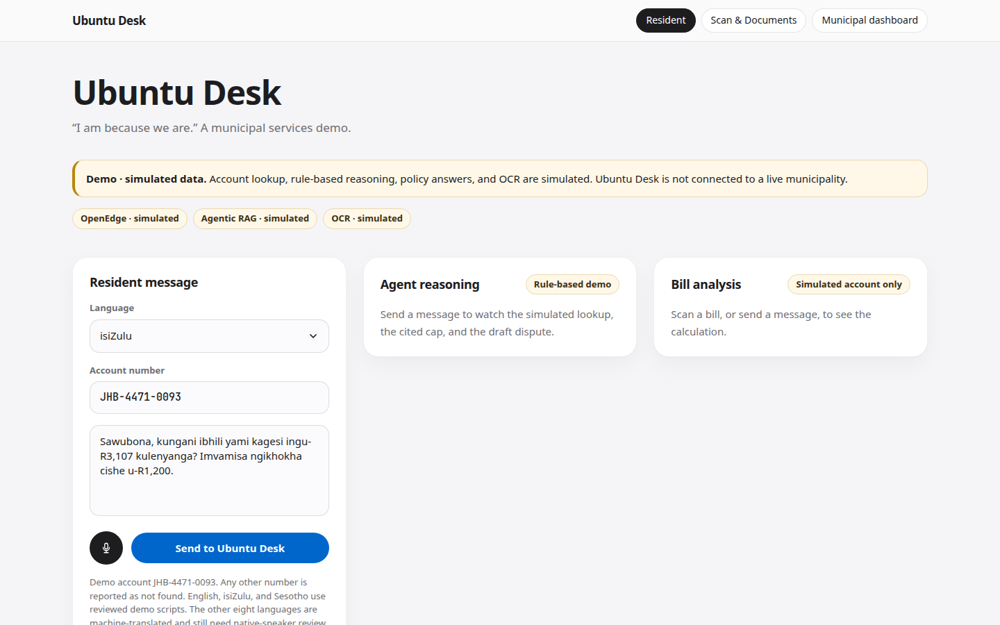
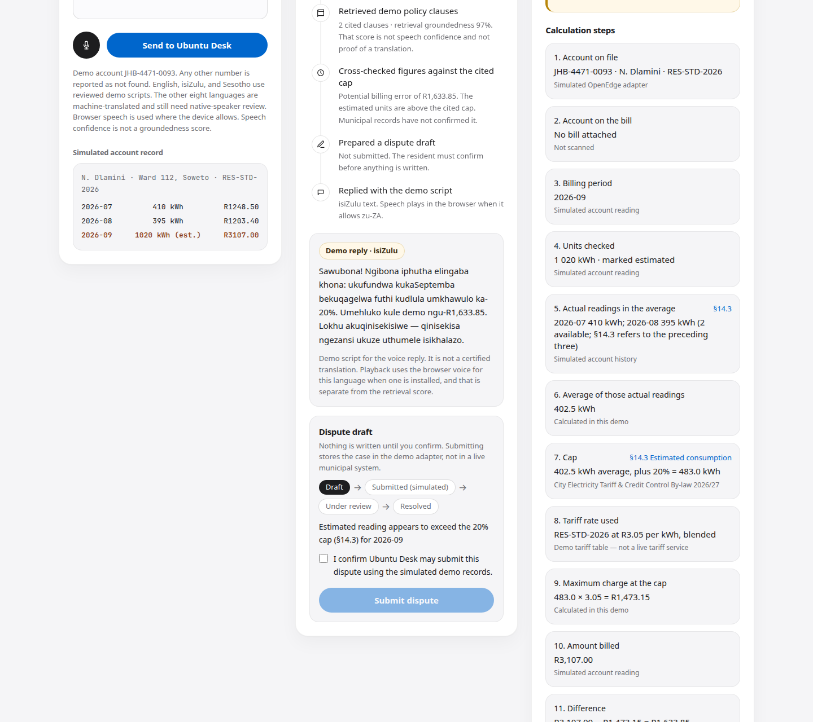
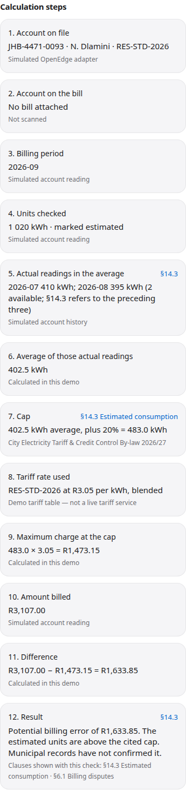
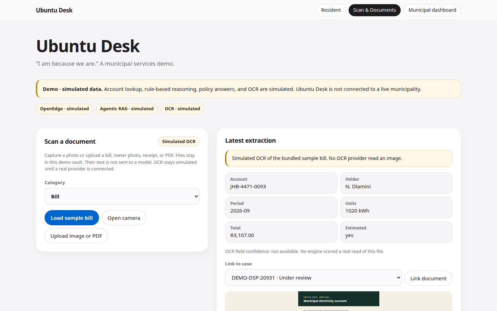
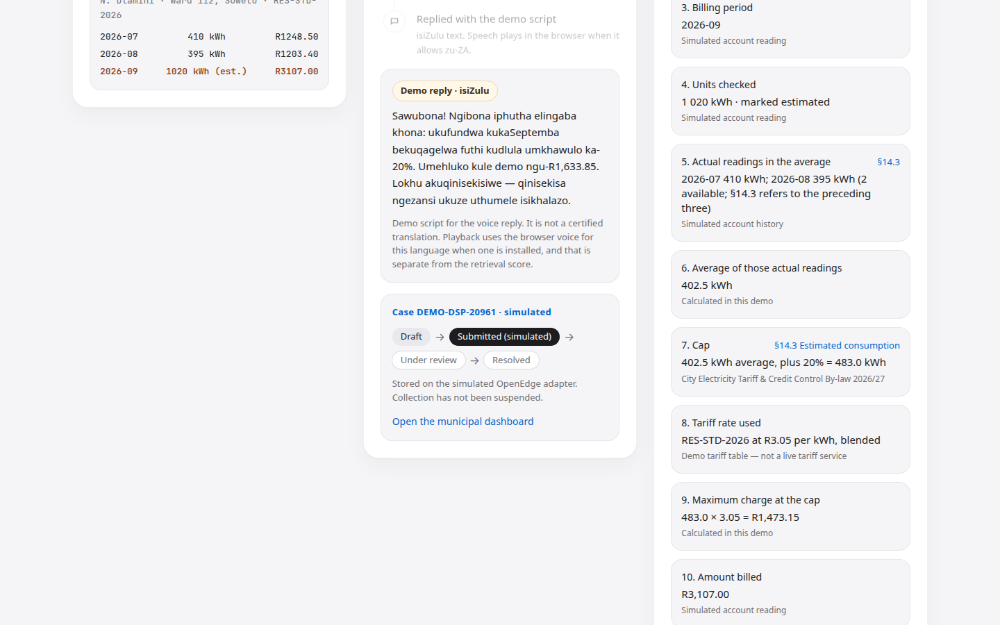
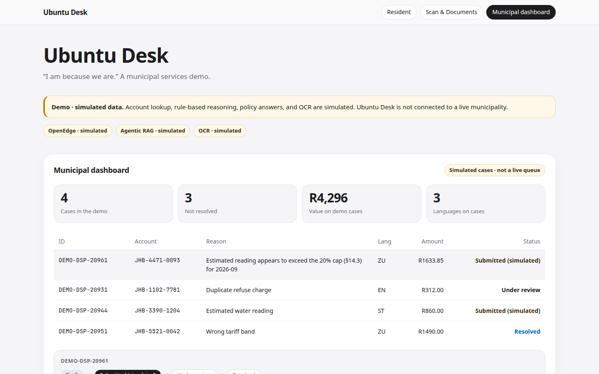
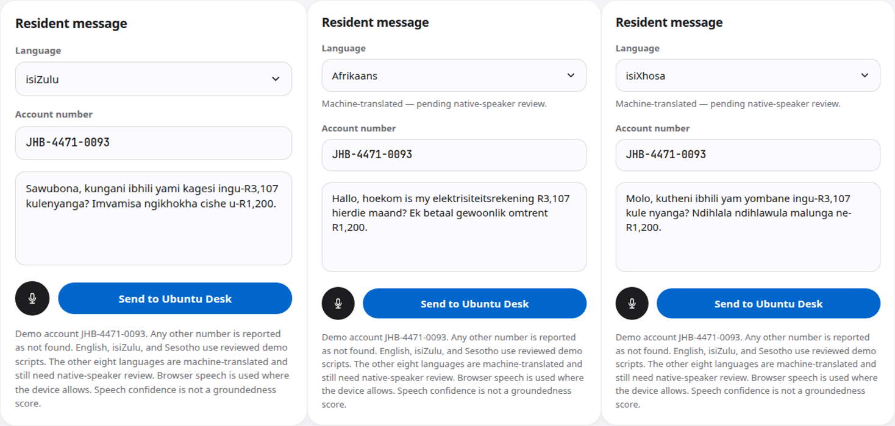
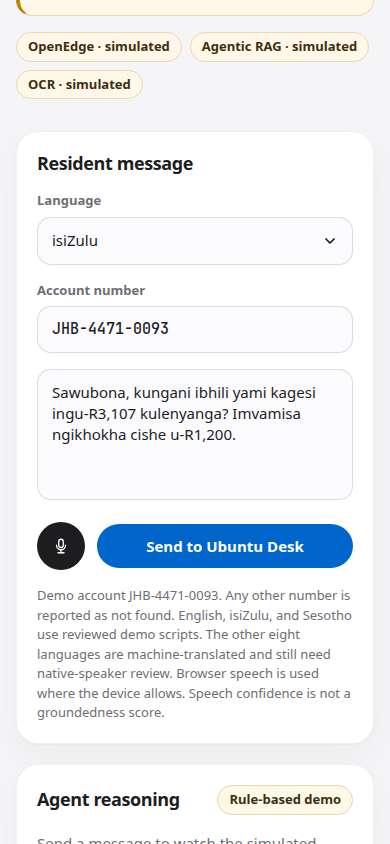
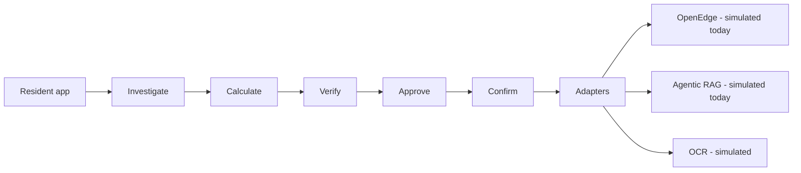
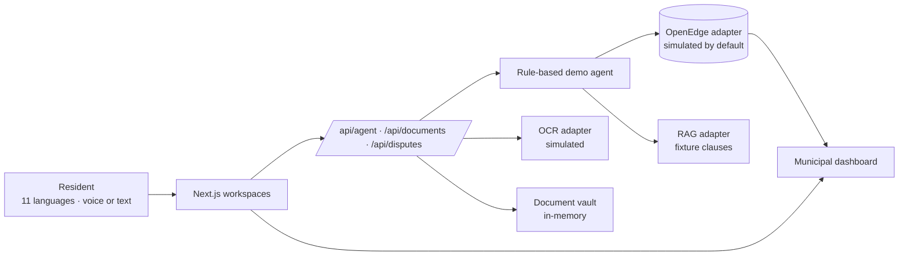

<h1 align="center">Ubuntu Desk</h1>
<p align="center">Ask in your own language. See the maths. Confirm the dispute.</p>
<p align="center"><strong>Team members:</strong> Katlego Mokwena (Creative Director &amp; Brand Strategist) and Prince (Systems/AI Engineer), CortexLab.</p>

<p align="center">
  <a href="https://github.com/black-abys/ubuntu-desk/actions/workflows/ci.yml"></a>
  
  
  
  
  
</p>

<p align="center">
  <a href="https://github.com/black-abys/ubuntu-desk/blob/main/demo/ubuntu-desk-demo.mp4"><strong>▶ Demo video (2–3 min)</strong></a>
</p>

<p align="center">
  
</p>

### Why it matters

A resident in this demo is looking at an electricity bill that moved from about R1,200 to R3,107, with an estimated reading and no explanation in their language. Ubuntu Desk shows the working: a deterministic check against the cited 20% cap (§14.3), and a dispute that is stored only after the resident confirms. Account lookup, policy answers, and OCR are simulated and labelled on screen, so what you see is a product demo, not a claim of a live municipality.

### What judges should try (60 seconds)

From `http://localhost:3000` after `npm run dev`:

1. [`/?autorun=1&lang=zu&fast=1`](http://localhost:3000/?autorun=1&lang=zu&fast=1) — isiZulu runs and stops on the unchecked confirm box. Find **R1,633.85** and **§14.3**.
2. [`/?autorun=1&lang=af&fast=1`](http://localhost:3000/?autorun=1&lang=af&fast=1) and [`/?autorun=1&lang=xh&fast=1`](http://localhost:3000/?autorun=1&lang=xh&fast=1) — the same finding in Afrikaans and isiXhosa, marked machine-translated.
3. [`/?workspace=scan&sample=1`](http://localhost:3000/?workspace=scan&sample=1) — the bundled sample bill. OCR is simulated.
4. Type `hello` and send it. You get a help reply, and no billing finding.
5. Change the account to anything other than `JHB-4471-0093` and ask about the bill. The account is not found.

Presenting on site? The three-minute script is [PITCH.md](PITCH.md).

### Gallery

| | |
|---|---|
| Resident screen | isiZulu finding, still unconfirmed |
|  |  |
| Step-by-step calculation | Scan and the sample bill |
|  |  |
| After confirm: DEMO-DSP, Submitted (simulated) | Municipal dashboard |
|  |  |
| isiZulu, Afrikaans, and isiXhosa | Mobile, 390 wide |
|  |  |

### How the demo is wired



The resident app is the Next.js workspace. The pipeline is the rule-based agent: it investigates only a bill or an account, calculates in `src/lib/billing.ts`, verifies against fixture clauses, and waits for the resident to approve. Adapters are the seams. OpenEdge, Agentic RAG, and OCR are simulated today. The real adapter files are scaffolds, not a live municipal connection.

### Responsible AI

- The overcharge is deterministic code. The same demo account always produces **R1,633.85**. A model does not invent the balance.
- The cap check cites the clause it used (§14.3). Retrieval groundedness is a demo score, not a legal conclusion, and it is separate from speech-recognition confidence.
- A dispute is written only after the resident ticks the confirm box. The server rejects a submit without that confirmation.
- The server also rejects an amount that is zero, negative, non-numeric, or above the calculated potential overcharge.
- Simulated account data, simulated OCR, simulated policy answers, and simulated case ids (`DEMO-DSP-…`) stay labelled in the interface.
- Nothing here suspends collection or files a case with a municipality.

---

# Ubuntu Desk 🇿🇦

**A multilingual municipal services demo for the AIGS / Progress OpenEdge Innovation Challenge 2026.**

Residents get electricity and water bills they cannot explain. Estimated readings are a common cause. Disputing one today means a queue, an explanation in English, and a wait. Ubuntu Desk is the product direction for a resident to ask in their own language, show the bill, see the calculation and the clause, and confirm a dispute.

**This build is a labelled demo.** Account lookup, policy answers, billing checks, and OCR are simulated. It is not connected to a live municipality, and it does not claim that OpenEdge or Progress Agentic RAG are already answering in production. The product plan is [ROADMAP.md](ROADMAP.md). The competition schedule is [PLAN.md](PLAN.md).

## Challenge use case

Residents query and dispute municipal bills. They ask in their own language, see how the figure was checked, and confirm before a dispute is stored. Progress OpenEdge is the system of record for the account and the dispute. This section describes the use case this demo implements. It does not quote an official kick-off brief.

## What the demo does

1. The resident picks one of the 11 official languages and sends text or speech.
2. A rule-based agent loads a **simulated** account and **fixture** by-law clauses, then shows its steps. It does that only when the message is about a bill or an account, in any of the 11 official languages. A greeting on its own gets a short reply about what the desk can help with, and no billing finding.
3. English, isiZulu, and Sesotho get a reviewed demo script. Afrikaans, isiNdebele, isiXhosa, Sepedi, Setswana, siSwati, Tshivenda, and Xitsonga get a static machine translation, labelled as pending native-speaker review. The browser speaks the reply when that voice is available, and otherwise uses an English voice. Typing still works when speech recognition does not support the language.
4. Scan & Documents accepts a camera frame, an upload, or the bundled sample bill. OCR is **simulated**. The file is kept in an in-memory vault and can be linked to a case.
5. When a bill is present, the screen shows each calculation step and the tariff clause. A mismatch is a **potential billing error** until records confirm it.
6. The resident must tick a confirmation before a dispute is submitted. The server rejects the dispute without that confirmation, and it rejects an amount that is zero, negative, non-numeric, or above the calculated potential overcharge for the account. Case ids are marked as demo ids (`DEMO-DSP-…`). The case then shows draft → submitted (simulated) → under review → resolved. Staff status changes in the dashboard are simulated too. The disputes API sets `simulated: true`.

Speech-recognition confidence (from the browser, when it reports one) is shown separately from retrieval groundedness. Groundedness here is a demo score on the fixture answer. It is not proof of a translation or a legal conclusion.

## Language support

| Code | Language | Typed demo | Spoken demo | Reply |
|---|---|---|---|---|
| `en` | English | Yes | Browser speech where available | Reviewed demo script |
| `zu` | isiZulu | Yes | Browser speech where available | Reviewed demo script |
| `st` | Sesotho | Yes | Browser speech where available | Reviewed demo script |
| `af` | Afrikaans | Yes | Browser voice, or English voice | Machine-translated, pending review |
| `xh` | isiXhosa | Yes | Browser voice, or English voice | Machine-translated, pending review |
| `nso` | Sepedi | Yes | Browser voice, or English voice | Machine-translated, pending review |
| `tn` | Setswana | Yes | Browser voice, or English voice | Machine-translated, pending review |
| `ss` | siSwati | Yes | Browser voice, or English voice | Machine-translated, pending review |
| `ve` | Tshivenda | Yes | Browser voice, or English voice | Machine-translated, pending review |
| `ts` | Xitsonga | Yes | Browser voice, or English voice | Machine-translated, pending review |
| `nr` | isiNdebele | Yes | Browser voice, or English voice | Machine-translated, pending review |

isiZulu and Sesotho lines are demo scripts for the prototype, not certified translations. The other eight official languages are machine translations committed in the repo. They are not certified translations and have not had native-speaker review.

## Scan and documents

Open **Scan & Documents**.

- **Load sample bill** uses `public/sample-bill.svg` (account `JHB-4471-0093`, period `2026-09`, 1020 kWh estimated, total R3,107.00).
- **Open camera** uses the device camera when the browser allows it. A captured frame is stored. This build does not read pixels, so the fields fall back to the sample bill and say so.
- **Upload image or PDF** stores the file. If the file contains labelled text (the sample SVG does), a simulated text match can fill account, period, and total. That match is not an OCR engine. Photos and most PDFs are not read.
- Categories: bill, meter photo, receipt, infrastructure, other. Bill maths runs for bills.
- The vault is process memory. It is cleared when the server restarts. Link a stored bill to a case id from the list.
- Previews are shown for the sample SVG and for small PNG, JPEG, or WebP uploads. Other types keep a filename only.

OCR and storage sit behind `OcrClient` and `DocumentStore` in `src/lib/types.ts`. Simulated implementations are the default. Scaffolds live in `src/lib/adapters/real/ocr.ts` and `real/documents.ts`.

## Technical approach

| Layer | In this demo | Later |
|---|---|---|
| System of record | `mock/openedge.ts` | Progress OpenEdge via PASOE REST |
| Knowledge | Fixture clauses and fixture retrieval scores | Progress Agentic RAG, with real citations and REMi scores |
| Billing | Rule-based cap check in `src/lib/billing.ts` | Tariff service plus verified readings |
| OCR / vault | Simulated extractor and in-memory vault | Pluggable OCR and private object storage |
| Agent | `src/lib/agent.ts` shows each step | Tool calling over tested adapters |
| Voice | Web Speech API | Reviewed voices per language |
| UI | Next.js 15, React 19, Tailwind 4 | Same app, three workspaces |

Interfaces in `src/lib/types.ts`:

- `OpenEdgeClient`: `getAccount`, `createDispute`, `updateDispute`, `listDisputes`
- `RagClient`: `ask`
- `OcrClient`: `extract`
- `DocumentStore`: `save`, `list`, `linkToCase`

`src/lib/adapters/index.ts` selects the implementation:

```
USE_REAL_OPENEDGE=1   OPENEDGE_BASE_URL=...   OPENEDGE_TOKEN=...
USE_REAL_RAG=1        RAG_API_URL=...   RAG_KB_ID=...   RAG_API_KEY=...
USE_REAL_OCR=1        OCR_API_URL=...   OCR_API_KEY=...
USE_REAL_DOCUMENTS=1  DOCUMENT_STORE_URL=...   DOCUMENT_STORE_TOKEN=...
```

Leave these unset for the demo. Do not commit tokens. A real adapter that has not been tested is labelled **unverified** in the header. It is still not a live municipal integration.



## Real vs simulated

| Area | What this demo actually does |
|---|---|
| UI | Real Next.js app. The screens say when the data behind them is simulated. |
| Bill calculation | Real, deterministic code in `src/lib/billing.ts`. The same inputs always produce the same figures. On the demo account the September estimated reading is a potential overcharge of R1,633.85. The R3.05/kWh rate is a demo constant, not a live tariff. |
| OpenEdge | Simulated. `mock/openedge.ts` is the system-of-record stand-in. Unknown account numbers are not found. There is no live PASOE connection. |
| Agentic RAG | Simulated. Fixture by-law clauses and fixture retrieval scores. Not Progress Agentic RAG. |
| OCR | Simulated. It does not read pixels. The sample bill and labelled text in a file are the only sources. |
| Document vault | Simulated process memory. It is cleared when the server restarts. |
| Dispute submission | Simulated. Ids look like `DEMO-DSP-20961`, the response includes `simulated: true`, and the submitted state is labelled simulated. Nothing is sent to a municipality. |
| Speech | The browser’s Web Speech API. If that browser has no voice or recogniser for the selected language, playback uses an English voice and recognition asks the resident to type. A recognition score is the browser’s, not a municipal score. |
| Translations | English, isiZulu, and Sesotho replies are reviewed demo scripts. They are not certified translations. Afrikaans, isiNdebele, isiXhosa, Sepedi, Setswana, siSwati, Tshivenda, and Xitsonga are static machine translations, labelled in the UI as pending native-speaker review. There is no live translation API. |

## Known limitations

- One simulated household account: `JHB-4471-0093`, N. Dlamini. Any other account number returns account not found.
- The assistant is a keyword check plus the billing rules. It is not a general chatbot and not a live model. A message that is not about a bill or an account does not produce a finding.
- The cap check is deterministic, and it is not a municipal determination. It uses two actual readings and a blended demo rate.
- OpenEdge, Agentic RAG, OCR, the document vault, and dispute submission are simulated. Restarting the server drops the vault and any disputes created in that process. The three seed cases come back from code.
- A submitted case does not file anything with a municipality and does not suspend collection.
- isiZulu and Sesotho demo scripts, including the short “what I can help with” lines, have not had a fresh native-speaker review in this change. Do not present them as certified translations.
- Afrikaans, isiNdebele, isiXhosa, Sepedi, Setswana, siSwati, Tshivenda, and Xitsonga are machine translations. The screen says so. They are not certified translations.
- Speech depends on the browser and the voices installed on the device. An unsupported language falls back to typing or an English voice.
- There is no resident login. Do not enter real personal information.

## Setup

Node 20 or newer.

```bash
npm install
npm test           # demo account overcharge is R1,633.85
npm run dev        # http://localhost:3000
npm run build && npm start
```

## Usage

Open the app locally and use one of these URLs. `confirm=1` is a presentation shortcut. In ordinary use the resident has to tick the box. `fast=1` skips the step delay and does not speak.

### Demo URLs

| URL | What it does |
|---|---|
| `http://localhost:3000` | Resident workspace, isiZulu sample text |
| `/?autorun=1&lang=zu` | Runs the isiZulu demo and stops on the confirmation checkbox |
| `/?autorun=1&lang=st&fast=1` | Sesotho, short delays |
| `/?autorun=1&lang=en&confirm=1&fast=1` | English, and the autorun URL confirms the dispute |
| `/?autorun=1&lang=af&fast=1` | Afrikaans machine translation, stops on the confirmation checkbox |
| `/?autorun=1&lang=xh&fast=1` | isiXhosa machine translation, stops on the confirmation checkbox |
| `/?workspace=scan&sample=1` | Opens Scan & Documents and loads the sample bill |
| `/?workspace=dashboard` | Simulated case list |

## Team members

Katlego Mokwena (Creative Director & Brand Strategist) and Prince (Systems/AI Engineer), CortexLab.

Katlego Mokwena — GitHub [@black-abys](https://github.com/black-abys).

## Screenshots

The current light-theme set is the gallery at the top: the resident screen, the isiZulu finding stopped before submit, the calculation, Scan & Documents at `/?workspace=scan&sample=1`, the simulated dispute lifecycle, the dashboard, three languages, and mobile.

| Resident | isiZulu finding | Scan |
|---|---|---|
|  |  |  |

## Project layout

```
src/app/api/agent/route.ts       demo agent
src/app/api/documents/route.ts   vault, simulated OCR, bill analysis
src/app/api/disputes/route.ts    confirm, list, simulated status changes
src/lib/agent.ts                 rule-based steps
src/lib/intent.ts                bill or account check, and the off-topic reply
src/lib/billing.ts               calculation shown in the UI
src/lib/languages.ts             11 official languages
src/lib/adapters/mock/           simulated OpenEdge, RAG, OCR, vault
src/lib/adapters/real/           scaffolds only
public/sample-bill.svg           bundled sample statement
ROADMAP.md                       2.0 product direction
PLAN.md                          competition plan through 29 Oct 2026
```
