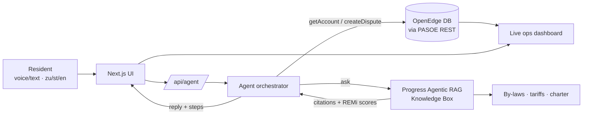
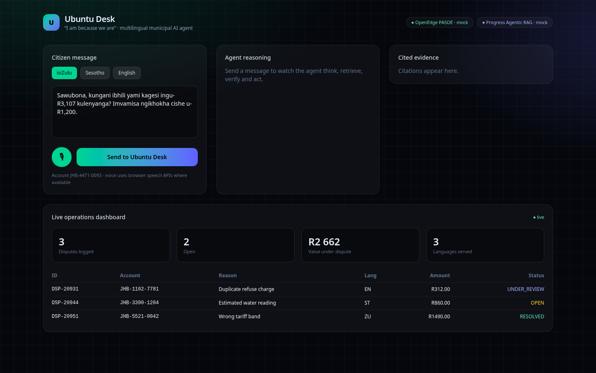
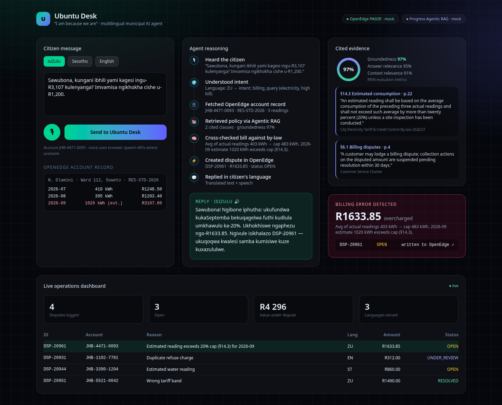
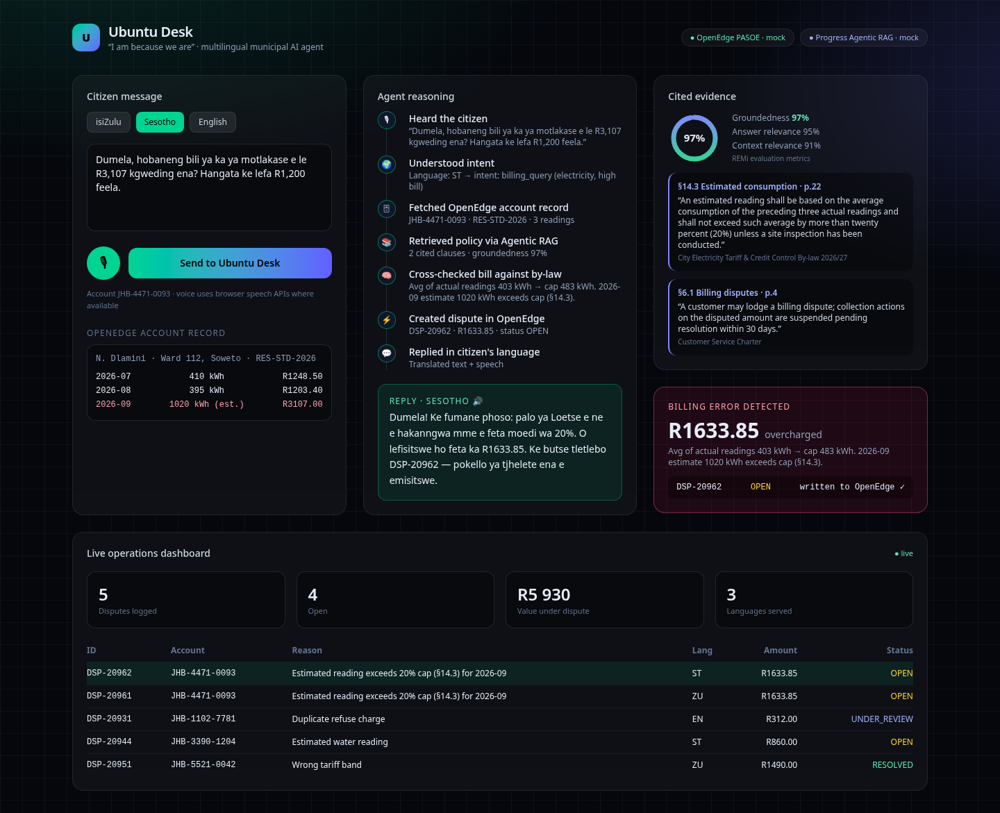

# Ubuntu Desk 🇿🇦
**A multilingual AI agent for municipal services, built on Progress OpenEdge and Progress Agentic RAG.**
*AIGS, Progress OpenEdge & AIE Innovation Challenge 2026*

## Project overview and problem
South African residents regularly get electricity and water bills they can't explain. Estimated meter readings are a common cause. To dispute one today, you queue in person, explain the problem in English, and wait. Many residents are more comfortable in isiZulu, Sesotho or another home language, and few people know the by-law clauses that protect them.

**Ubuntu Desk** lets a resident send a voice or text message in their own language. An AI agent then:
1. works out what they're asking,
2. pulls their account from the municipality's **OpenEdge** system of record,
3. finds the relevant by-law clauses with **Progress Agentic RAG** and cites them,
4. checks the bill against those rules and finds the error,
5. **creates a dispute record in OpenEdge**, and
6. replies in the resident's language, in text and speech.

Staff see every case on a live operations dashboard.

## Technical approach: how OpenEdge and AI are used
| Layer | Technology | Role |
|---|---|---|
| System of record | **Progress OpenEdge DB + PASOE REST** | Accounts, meter readings, tariffs, disputes (read *and* write) |
| Knowledge layer | **Progress Agentic RAG** (Knowledge Box) | Tariff by-laws, customer charter and FAQs; answers come with citations and **REMi** groundedness and relevance scores |
| Agent | TypeScript orchestrator (`src/lib/agent.ts`) | Understands the request, then looks up the account, retrieves policy, reasons over both, acts, and replies; every step is shown in the UI |
| Voice & language | Web Speech API (STT/TTS) + multilingual LLM | isiZulu, Sesotho and English |
| UI | Next.js 15, React 19, Tailwind 4 | Demo UI and live dashboard |

The backends sit behind two interfaces in `src/lib/types.ts`:
- `OpenEdgeClient`: `getAccount`, `createDispute`, `listDisputes`
- `RagClient`: `ask(question, {lang})`, which returns `{answer, citations, remi}`

`src/lib/adapters/index.ts` chooses the mock or real implementation from environment variables:
```
USE_REAL_OPENEDGE=1  OPENEDGE_BASE_URL=...  OPENEDGE_TOKEN=...
USE_REAL_RAG=1       RAG_API_URL=...  RAG_KB_ID=...  RAG_API_KEY=...
```
The real adapters (`src/lib/adapters/real/*`) are scaffolds. Their endpoints and payloads still need to be completed from the OpenEdge starter kit and the Agentic RAG documentation.

## Architecture


## Setup
Requirements: Node 20+.
```bash
npm install
npm run dev        # http://localhost:3000  (mock backends)
npm run build && npm start
```
To use the real backends, copy the variables above into `.env.local`.

## Usage guide
1. Choose a language: isiZulu, Sesotho or English.
2. Tap 🎙 to speak (Chrome), or use or edit the sample message.
3. Press **Send to Ubuntu Desk** and watch the agent's reasoning steps.
4. On the right you'll see the cited clauses, the groundedness gauge, the detected overcharge and the new dispute ID.
5. The new dispute appears at the top of the live dashboard.

Shortcut for demos and screenshots: `/?autorun=1&lang=zu` (add `&fast=1` to skip the animation delays).

## Screenshots
| Idle | isiZulu flow | Sesotho flow |
|---|---|---|
|  |  |  |
